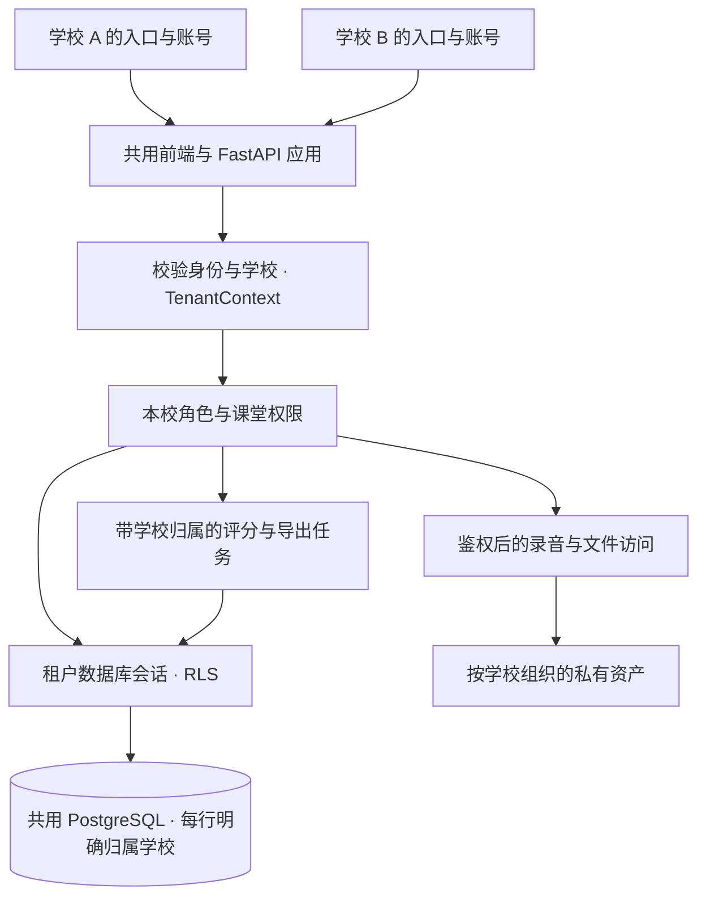

# 多学校多租户方案（设计稿）

日期：2026-10-31。状态：供产品与研发评审，尚未实施。

需求真相源：[Notion 多租户商用改造 · V1.0 完整需求方案](https://app.notion.com/p/4099aef5c21081c2bde7e1ad7170ab76)。该条目已整合既有 zocode 盘点，保留旧稿归档；当前产品范围、FR/AC 编号与上线条件以其顶部 V1.0 为准，本文作为技术设计配套。第二校接入前必须完成全业务隔离与验收，身份/班级阶段不能单独视为安全上线条件。

## 1. 推荐决策

采用 **一所学校一个租户，共用应用、共用 PostgreSQL 数据库，通过 tenant_id 和数据库行级安全（RLS）隔离**。保留独立实例交付能力，有明确隔离或专属容量要求的学校使用同一代码版本单独部署。

第一阶段目标是让第二所学校安全入驻、自主管理教师学生、独立使用题库和查看用量，同时保持现有学校的课堂与考试行为。暂不建设集团跨校管理、跨校统一账号、自助付款、任意学校定制代码分支。

假设首批是少量学校，学校内仍采用当前“老师发布、学生同步练习”的教学方式；具体校数和容量必须通过真实负载验证，不按学校数量承诺承载能力。

| 方案 | 优点 | 代价 | 本项目建议 |
|---|---|---|---|
| 每校独立应用和数据库 | 故障、数据、恢复边界清楚 | 部署、升级、监控随学校增多 | 专属交付选项；可用于正式多租户完成前的紧急试点 |
| 共用应用、每校一个数据库 | 数据边界清楚、可单校恢复 | 连接池、迁移、任务调度需识别多个数据库 | 暂不采用 |
| 共用数据库、每校一个 schema | 表结构分开 | schema 路由、迁移、search_path 管理复杂 | 暂不采用 |
| 共用数据库、共享表 + RLS | 延续现有 ORM 和部署方式，统一升级 | 必须系统改造隔离、权限、任务与文件 | 默认方案 |

同库 RLS 提供逻辑隔离，不消除实例故障、管理员误操作或资源争用的共同影响。

## 2. 当前项目与改造边界

以下是代码检查结果，而非推测：

| 现状 | 多校改造要求 |
|---|---|
| `User.email`、`User.username` 全局唯一；登录先按学号再按邮箱找人 | 登录先确定学校，唯一约束改为校内；明确邮箱与学号匹配规则 |
| `role=admin` 与 `is_superuser` 绑定，权限辅助函数给管理员直接放行 | 区分学校管理员和平台运营；校管理员不能绕过学校边界 |
| 课堂按 `Classroom.owner_id` 控制教师归属 | 保留课堂归属，在其之前增加学校校验 |
| 题库有 `owner_id` 编辑保护，未指定创建者的题目可由教师编辑 | 这些题目仍属于确定学校；禁止把 NULL owner 解释为跨校公共 |
| `Passage.slug`、`Scenario.topic`、课堂码全局唯一 | 前两者改为校内唯一；课堂码第一阶段保留全局唯一以兼容旧链接 |
| `Student` 是一个账号在一个课堂里的档案，历史匿名档案的 user_id 可空 | 不把 Student 当作全校唯一学生；租户从课堂链路推导，保留旧档案 |
| 评分与导出使用线程池，并在多处独立创建 Session，支持启动恢复 | 每次新事务与恢复任务都必须绑定租户 |
| 录音、标准音保存在共享本地音频卷；TTS 有内容寻址缓存 | 增加资产归属和下载鉴权，缓存键纳入租户或显式公共命名空间 |
| 现有备份为整库和整音频卷备份，当前文档注明无异地副本 | 保留全量灾备，增加异地副本和单校恢复流程 |
| 大盘有全局指标、日快照和费用核对 | 学校用量与平台总览分开；历史总费用不能直接准确拆到学校 |

关键入口：`backend/app/models.py`、`api/deps.py`、`api/routes/login.py`、`crud.py`、`services/content_access.py`、`core/storage.py`、`scoring/worker.py`、`exporting/worker.py`、`frontend/src/hooks/useAuth.ts`。

## 3. 学校、账号与角色

### 3.1 租户边界

- `Tenant` 表示一个独立授权、独立管理数据的学校。校区、年级、课堂在学校内部；首期不增加集团层级。
- 同一集团下如果学校需要互相隔离，各自建 Tenant。将来再增加集团及明确的跨校授权，不预先允许共享。
- 第一阶段一个学校账号只属于一个租户。教师在两校任教时分别使用两校账号；相同邮箱可以出现在不同学校。
- 后续确有统一登录需求，再增加全局身份与学校账号的映射，保留现有学校账号 ID 和历史成绩归属。

这样能保留现有 `User → Student（课堂档案）→ Session → Attempt` 主链路，避免第一次多租户改造同时重做身份系统。

### 3.2 权限矩阵

| 身份 | 学校管理 | 课堂与学生 | 题库 | 其他学校 |
|---|---|---|---|---|
| 平台运营 | 开校、停用、额度、整体运行状态 | 默认无教学明细访问权 | 维护平台授权资源目录 | 仅运营元数据 |
| 学校管理员 | 本校设置、教师、学生、额度查看 | 本校全量；敏感导出留审计 | 管理本校题库 | 无权 |
| 教师 | 本人账号 | 本人负责的课堂、其中的学生 | 本校可见内容；编辑沿用归属规则 | 无权 |
| 学生 | 本人账号 | 本人的课堂与作答 | 通过发布快照和既有自主练习入口访问 | 无权 |

学校管理员可删除/停用本校学校账号，不能删除所谓“跨校全局身份”。停用账号优先于物理删除；离职交接必须转交课堂与题库归属，不能因 `SET NULL` 意外扩大编辑权限。

平台运营使用独立 `PlatformOperator` 身份和独立 audience 的凭证，不复用学校 `User.is_superuser`。学校用户模型中移除这一全局绕过概念；过渡期必须审计并替换所有 `is_superuser` 分支，不能只改 UI 名称。旧学校 admin 迁为 `school_admin`，平台运营账号单独建立，不把旧管理员自动升级为跨校运营。

平台支持需要看教学明细时，使用有学校、范围、理由、过期时间的 SupportGrant。授权后签发仅绑定该校的短时支持凭证，记录真实操作人，不冒充教师，不给业务数据库连接添加全局绕过权限。紧急运维走受控工具与审计。

## 4. 数据模型

### 4.1 新增与调整

| 模型 | 主要字段与约束 |
|---|---|
| Tenant | UUID id、唯一 slug/学校代码、中英名称、状态、时区、创建时间 |
| TenantSettings | tenant_id 唯一；Logo 资产、主题、默认语言、功能开关；限制 JSON 配置可写字段 |
| TenantEntitlement | tenant_id、有效期、功能授权、账号/存储/AI 额度、策略版本 |
| User（调整） | tenant_id NOT NULL、school_admin/teacher/student、校内登录标识；保留 UUID |
| PlatformOperator | 独立运营身份、状态；不与学校管理员混用 |
| SupportGrant / AuditEvent | 学校、操作人、授权范围/操作、对象、时间、请求 ID；不得记录密码/录音正文 |
| FileAsset | tenant_id、用途、storage_key、MIME、大小、状态；资源引用和授权入口 |
| UsageEvent / UsageReservation | 学校、任务/供应商请求、数量、状态、版本和唯一结算键 |

`TenantSettings` 只能配置经过允许的品牌和教学选项，不允许注入脚本、任意 URL 或数据库连接串。密钥通过现有部署 Secrets 管理；以后如支持学校自带 AI Key，独立使用密钥管理系统，业务配置只存引用。

### 4.2 表的归属分类

上线前必须形成完整的表清单，以下按当前 `models.py` 覆盖业务分类：

| 类型 | 当前模型 | 设计 |
|---|---|---|
| 身份和课堂 | User、Classroom、Student | 全部明确 tenant_id |
| 口语和考试 | ClassroomExercise、ComposerDraft、PracticeSession、Attempt、InstructionAck、ItemListen | 全部 tenant_id；考试流程若存于会话/JSON，同样继承会话归属 |
| 教学反馈 | ClassroomReview、FollowupBatch、ClassroomMessage | 全部 tenant_id |
| 激励与收藏 | StudentBadge、StudentExpressionFavorite、StudentFrameFavorite | 全部 tenant_id |
| 本校题库 | Unit、Passage、RepeatSentence、Scenario、ScenarioQuestion、Instruction、SentenceFrame | 全部 tenant_id；owner_id 只控制校内编辑 |
| 背单词 | VocabularyWord、VocabularyBook、VocabularyBookItem、VocabularyAssignment、VocabularyAssignmentTarget、VocabularySession、VocabularyAnswer、VocabularyAiCache | 全部 tenant_id；public scope 明确定义为校内公共 |
| 五级词库 | VocabularyLevelEntry | 存量先归原学校；确认来源授权后才将可分发版本纳入平台资源目录 |
| 导出 | ExportJob、ExportAudit | 全部 tenant_id；审计保留策略单独定义 |
| 运营 | AdminMetricsDaily、AdminCostReconcile | 原表保留平台口径、平台专用接口；新增学校统计和用量事件，不将总额伪装成学校账单 |
| 更新日志 | ChangelogEntry | 默认平台发布、学校只读；未来校内公告独立建表 |

原则：学生和教学业务表没有 `tenant_id=NULL` 的“公共”例外。平台资源目录单独建表，避免在所有业务查询里散落 `tenant_id = 当前学校 OR tenant_id IS NULL`。

### 4.3 约束和索引

- `UNIQUE(tenant_id, normalized_username)`、`UNIQUE(tenant_id, normalized_email)`；空邮箱沿用 PostgreSQL 可空唯一语义。规范化规则在所有导入、新建、更新、登录、找回密码路径一致执行，迁移前报告校内规范化冲突。
- 邮箱和学号不能发生跨字段歧义：建议新学号禁止 `@`，包含 `@` 的输入走邮箱；存量冲突先清点并保留兼容登录方式，不能静默改学号。登录提示不泄露其他学校是否存在同名账号。
- `Passage.slug`、`Scenario.topic` 改为 `(tenant_id, 原字段)` 唯一；现有课堂码保持全局唯一，不等于跨校可访问。
- 继续使用全局 UUID 主键。父表增加 `UNIQUE(tenant_id, id)`，子表用复合外键 `(tenant_id, parent_id)` 约束同校引用，包括 user、classroom、student、session、exercise、题库父子和词库关系。
- 可空关系需要特别设计删除行为：不能把复合 FK 的 tenant_id 随 `ON DELETE SET NULL` 一并置空；只清引用列，或显式交接/更新后删除。循环课堂/练习引用沿现有迁移策略分步建约束。
- JSON 中的题目、补练对象和导出筛选器不能由复合外键保护：发布/保存前逐项校验当前校可见性；读取历史仍按不可变快照解释。
- 常用索引从 tenant_id 开始，例如 `(tenant_id, classroom_id, created_at)`、`(tenant_id, student_id, created_at)`；按真实查询与执行计划补充，不给所有列机械加索引。
- 已有全局随机幂等键可以保留全局唯一；发现键已存在时先按租户与会话核验，错误响应不能返回他校对象或泄露其内容。

## 5. 请求、登录与数据库隔离

### 5.1 学校入口

首期使用同域学校入口 `/s/{school_slug}/login`，学校可直接分发链接和二维码。学校页显示名称、Logo、中英切换；学号相同也不影响不同学校登录。普通用户输入校码进入学校，课堂码只负责进入课堂。

登录将 school_slug 解析为租户后，按 `(tenant_id, 登录标识)` 查找账号并验证密码。注册、邀请、导入、改密、重置密码都绑定学校；重置凭证含学校、用户、用途和过期时间。学校不能通过开放注册自行获得管理员权限。邀请链接单次使用、有期限且限制角色。

JWT 至少携带 `sub`、`tenant_id`、`aud`、`exp`、现有密码指纹、凭证版本；角色声明用于展示，后端仍检查账号当前状态与角色。学校停用和权限撤销不能等 JWT 自然过期才生效。

路径中的学校、请求头或未来子域名只能提出目标学校，服务端必须与签名凭证及数据库用户归属核对。跨校资源返回 404；同校权限不足返回 403；401 沿用仅表示 token 无效/过期的约定。有效 token 指向另一学校入口，返回 403 并允许用户主动换校登录，不自动登出其他页面。

保留现有 `/p/{code}`、`/exam/{code}` 等链接：只在受限入口解析器中查找全局唯一课堂码并确定目标学校，最多返回必要的公开入口信息；随后要求该校身份或绑定该校/课堂的历史学生凭证。不能凭课堂码获得名单、题单、录音或分数。

### 5.2 TenantContext 与权限顺序

统一新增 `TenantContext`，包含 tenant_id、user_id、角色和请求关联 ID。依赖顺序：校验凭证 → 受限读取学校/账号状态 → 建立租户上下文 → 业务数据库会话 → 校内角色/课堂/内容权限。

身份引导查询需要单独受限连接/函数：只允许按精确学校和登录标识读取认证必需信息，禁止业务列表和教学数据查询。不能为了绕开登录前没有 RLS 上下文，给所有业务连接永久 BYPASSRLS。

业务代码显式使用 `tenant_id` 查询和创建数据；客户端提交的 tenant_id 不作为写入来源。`session.get(Model, id)`、批量加载、统计、联表、原生 SQL、导入查重、导出都进入隔离审计范围。学校管理员仍必须使用有租户约束的会话。

### 5.3 RLS 作为第二道防线

每张租户业务表启用 `ENABLE ROW LEVEL SECURITY` 和 `FORCE ROW LEVEL SECURITY`，读/删使用 `USING`，写入/更新使用 `WITH CHECK`。策略仅允许行 tenant_id 与当前事务上下文一致。没有租户上下文时默认拒绝。

事务内使用参数化 `set_config('app.tenant_id', ..., true)` 设置租户。PostgreSQL 的 transaction-local 设置会在事务结束后失效；**现有代码多次 commit 并创建新 Session，必须在每一次新事务开始时重新绑定**，不能只在请求刚进入时设一次。建议统一 `TenantSession` 工厂配合 SQLAlchemy 事务开始事件，覆盖路由、服务、脚本、恢复和任务线程；禁止在同一个 Session 中更换租户。

普通运行用户不得是超级用户、表 owner 或拥有 BYPASSRLS；迁移使用单独角色。RLS 不限制 TRUNCATE，也不代替外键约束；业务角色不得拥有 DDL/TRUNCATE 权限。平台统计采用独立受控路径，不开放一个客户端可切换的“关闭 RLS”开关。

RLS 防御遗漏查询条件，不能抵御被完全攻破的应用任意设置租户上下文；需要物理边界的客户使用独立部署。

## 6. 题库共享与历史成绩

建议采用三层内容来源：平台授权模板、本校公共题库、教师个人归属。首期只必须实现学校隔离，校内可见性延续当前习惯（全校教师可选用、修改受归属保护），不同时强推私有题库。

- 原学校所有现存题库、单元、词条、AI 草稿及标准音先归原学校；不因“存量”“无主”自动成为平台共享资源。
- 平台目录只上架明确可对外分发的材料。EIP 等校方教材、校方上传内容和学生录音不得自动复制给新学校。
- 平台内容通过“复制到本校”使用，记录来源和源版本；复制根对象、子对象及必要资产，生成本校 ID。教师修改副本不影响原模板或其他学校。
- 首期实际复制标准音资产到本校空间，简化删除、导出和独立迁移；日后确需去重，再建设显式共享资产授权与引用计数。
- 旧题库的 `owner_id=NULL` 在原校内部维持现有规则；跨校请求在到达编辑归属判断前已被拒绝。
- 发布继续深拷贝 `ClassroomExercise.snapshot_items`，作答继续保存 `Attempt.item_snapshot`。只增加归属，不重算历史成绩、不更新快照正文、不改变旧词表分析结果。

本方案是 `question-bank-ownership-design.md` 的学校边界补充；其中“校内/公共”需要按这里重新解释，不能继续代表全站所有教师。

## 7. 录音、缓存、前端与后台任务

### 7.1 文件和缓存

- 文件键采用 `tenants/{tenant_id}/recordings/...`、`content/...`、`exports/...`；数据库资产记录才是授权依据，目录前缀只是组织方式。
- 首期可保留本地卷；通过 Storage 接口封装，水平扩容前迁移到所有 worker 可访问的私有对象存储。不能让第二个实例读不到第一个实例的录音。
- 录音、ZIP、PDF、校内标准音都先校验身份和学校，再代理返回或签发短时下载链接；不提供公开静态目录。标准音若由历史学生凭证访问，凭证必须绑定学校/课堂并验证发布快照引用。
- 旧 `/audio/content/{filename}` 等已进入快照的 URL 保持可解析，通过资产映射鉴权兼容，不批量修改历史快照。旧文件建立归属映射后再后台搬迁，校验大小/摘要并支持新旧路径过渡。
- TTS、VocabularyAiCache、词表内存缓存、导入预览、限流桶都纳入租户。公共缓存仅保存经确认可公开复用的内容，并单独命名空间，学生转写和校内教材不能进入。
- 前端查询键和 localStorage/IndexedDB 录音草稿至少包含 tenant_id、user_id；同域多校时，课堂码和预设缓存也要区分学校。
- 换校需取消请求、清查询缓存、停止轮询/录音、清理或正确隔离草稿并重新登录。首期一个浏览器会话只保持一个学校登录，跨标签页同步身份变化，避免旧页继续提交。
- 品牌由 TenantSettings 提供，保留平台产品署名；面向用户文案全部中英双语，新入口检查 390/820/1180 宽度。

### 7.2 评分与导出

现有线程池可以作为第一阶段执行器，但必须先完成以下改造：

1. 持久化任务记录包含 tenant_id、对象 ID、状态、重试、租约及必要的执行配置版本；投递通过数据库提交后触发，投递失败可由恢复扫描补回。
2. worker 显式接收可信 `(tenant_id, task_id)`，再次核验任务归属；重开事务、进度更新、失败处理和重试都走 TenantSession。不能只依赖 HTTP ContextVar 继承。
3. 启动恢复和定时清理采用受限任务调度入口，按学校逐批执行；受限全局扫描仅输出任务定位字段，不能把全局业务 Session 交给 worker。
4. 每校并发上限、公平轮转、全局供应商并发上限必须同时存在；一次全校考试不能把别校评分永久挤出。超过即时容量进入队列，不因短时高峰直接丢作答。
5. 额度预占与任务入库原子完成；重复执行不重复扣减，重试与外部供应商实际重复收费分别记录。
6. 学校暂停新增任务时，已接收考试作答与在途任务按既定策略完成；安全封禁则立即停止对外访问并隔离待处理任务。执行前重新确认状态与授权策略。

多实例前需将任务认领、租约、并发额度与限流放到共享状态中。可先使用 PostgreSQL 持久任务和租约实现，再按压测决定是否引入专用队列；仅增加 Redis 并不能自动解决任务幂等和租户公平性。

## 8. 商业化与运营

第一版支持人工开通、设置到期时间、功能授权与 AI/存储额度，不把支付系统作为多租户前置条件。

学校独立看到账号数量、录音存储、作答与评分数量、AI 消耗、排队与失败情况。用量事件记录租户、供应商、模型、任务 ID、请求 ID、计量单位和估算单价版本。唯一键保证重试不会重复入学校账；供应商账单按实际资源再核对。历史总账保留“未分摊”，不能按学生数量冒充精确成本。

AI 额度达到阈值提前告警，开考前进行容量和预算检查；常规额度/到期在考试中触发时不打断已开始考试，预留已接收作答的处理空间并停止新增高成本操作。安全封禁单独处理。具体宽限、超额收费与录音保留期限由商务约定，首期不写死在代码里。

租户生命周期区分：试用、正常、仅禁止新增、停用访问、归档、待删除。合同到期、停用访问、删除数据不是同一个动作；删除前支持校方导出、确认引用范围和留存期限，执行后台清理并审计。保留备份中的删除数据随备份周期过期，恢复后必须重新应用删除清单。

备份保持整库灾备，并增加异地加密副本。单校误删恢复到临时隔离实例，按依赖图提取该校及其资产，再经校验导回；不能把旧整库覆盖生产来恢复一所学校，也不能承诺数据库共享模式天然具有单校时间点恢复。恢复演练应覆盖登录、原录音、标准音、快照、导出与后台任务。

## 9. 现有学校迁移

采用扩展 → 回填 → 校验 → 收紧 → 开第二校的顺序。旧服务只在单校兼容窗口运行，多校数据写入后禁止回滚到不识别租户的版本。

1. **准备**：完整备份、隔离恢复演练；盘点表、API、脚本、公开文件入口、缓存、任务；记录行数、快照摘要、考试中会话和未完成任务。建立原学校 Tenant，冻结公开注册等不受控建号入口。
2. **扩展**：新增可空 tenant_id、辅助表与新代码；单校窗口内新代码显式写原学校 ID。旧进程仍可能漏写时要有追补与切换检查，不能视为已经完成。
3. **回填**：User/题库/课堂归原学校；Student 从课堂推导，Session/Attempt/词汇/点评/导出逐层沿父关系回填；历史匿名 Student 不凭空建账号。父子租户冲突或孤儿记录进入人工清单，不自动猜归属。
4. **资产和凭证**：生成旧文件归属清单，处理缺失/多引用资产；旧 JWT 因缺少租户信息统一失效，用户重新登录。历史学生凭证需要换发或在明确单校兼容期受限解析，切入多校前结束无租户授权路径。
5. **收紧**：检查无 NULL、无跨校关联、规范化标识无冲突；添加非空/唯一/复合 FK/RLS，改运行数据库角色。替换全部全局 admin 守卫、全站列表和非租户 Session，移除默认回落到原学校的逻辑。
6. **验收和试点**：先用合成 B 校账号走越权测试，再开真实试点学校；对照原学校关键链路和历史录音/成绩。数据回填可分批在线执行，最终切换安排维护窗口、停止旧进程、排空或持久化在途任务。

回滚边界：多校写入前可依据演练回退扩展阶段；多校写入后只能部署明确支持租户的上一版本或向前修复。回退应用不能恢复已经发生的业务写入，必要的数据恢复按事故流程单独决定。现有 `scripts/rollback.sh` 的上一版镜像必须经过兼容性检查才可使用。

## 10. 分期与工作量

以下是按单名熟悉项目的工程师的初步开发工作量，含针对性测试，不是交付承诺；完整盘点后重新估算，实施时拆为可评审 PR。

| 阶段 | 交付 | 初步工作量 |
|---|---|---|
| A：盘点与设计验证 | 完整边界清单、RLS/连接池验证、迁移演练方案 | 2–3 人日 |
| B：租户基础和身份 | Tenant、校内账号/约束、学校登录、角色拆分、TenantSession | 5–8 人日 |
| C：所有业务隔离 | 题库/课堂/考试/词汇/导出、资产、任务、缓存、历史兼容 | 10–15 人日 |
| D：学校运营能力 | 校设置、教师学生管理、人工开通、用量额度、公平调度 | 5–8 人日 |
| E：切换验收 | 回填与恢复演练、越权测试、课堂并发压测、两校试点 | 4–6 人日 |

合计约 26–40 人日；学校试用、素材授权核验、商务流程和问题修复另留日历缓冲。第二所学校接入共享生产系统前，B/C 的全部安全边界和 E 的关键验收必须完成，不能只做表加字段就开放。

后续再做：统一跨校身份、集团报表、学校自带 Key、SSO、自定义域名、自助支付、专属部署自动化。自定义域名需单独完成域名归属验证与 HTTPS 配置，麦克风继续要求安全上下文。

## 11. 上线验收门槛

所有数据库测试仅使用独立 `app_test`。RLS 测试使用与生产权限一致的普通数据库角色，不能只用测试超级用户验证。

- A/B 两校均建管理员、教师、同学号学生；A 校管理员和教师不能读写 B 校任何教学对象、名单、统计、批量接口、导入预览或导出任务。
- URL/请求体/关联 ID/课堂码/下载文件名替换成 B 校对象均拒绝；403 不触发退出登录，跨校对象 404 不泄露存在性。
- 同校教师课堂归属仍生效；学生只能看本人结果；未指定创建者的题目仅校内可用；匿名历史凭证不能跨校访问。
- 无上下文的查询/写入默认失败；commit 后新事务重新绑定；复用同一物理连接先服务 A 再服务 B 不串校；复合 FK 拒绝跨校关联；批量操作与原生 SQL 受约束。
- 评分、重试、启动恢复、清理、PDF/ZIP、下载审计全部保留租户；学校暂停/撤权对在途与新任务按规定生效。
- 同时提交不同学校任务不重复计费且无学校长期饥饿；模拟整班同步录音上传、轮询、评分和导出混合负载，记录响应时间、队列等待、错误率和数据库连接峰值后再定容量。
- 原校历史快照/成绩摘要不变，旧链接与音频可回放；旧凭证按计划失效；跨学校切换无旧缓存或草稿泄露。
- 学校设置与登录等新页面中英双语，并通过 390/820/1180 宽度检查。接口/模型实施后生成 Alembic 迁移与前端客户端，执行现有 CI 漂移校验及相关回归。
- 完成一次全量恢复和一次单校恢复演练；多校版本回滚不会执行不识别租户的旧镜像。

## 12. 产品评审建议默认值

| 决策 | 建议默认值 | 何时调整 |
|---|---|---|
| 学校与校区 | 独立管理的学校一个租户，校区在校内 | 集团明确要求统一管理时 |
| 跨校账号 | 分学校登录，相同邮箱可复用 | 确认有大量跨校任教或集团统一登录需求时 |
| 新校题库 | 只初始化授权演示/平台模板，不复制原校教材 | 获得明确分发授权后 |
| 商业授权 | 人工开通，按学校功能/期限/额度控制 | 收费模式稳定后再接自助支付 |
| 专属隔离 | 同版本独立实例作为选项 | 学校要求独立备份、专属容量或物理边界时 |

## 13. 技术依据

- [PostgreSQL 18：Row Security Policies](https://www.postgresql.org/docs/18/ddl-rowsecurity.html)：RLS 默认拒绝、USING/WITH CHECK、owner 与超级用户绕过、FORCE 和 TRUNCATE 例外。
- [PostgreSQL 18：Configuration Settings Functions](https://www.postgresql.org/docs/18/functions-admin.html#FUNCTIONS-ADMIN-SET)：`set_config(..., true)` 仅作用于当前事务，解释了为什么本项目多次 commit 和后台新 Session 都必须重新绑定。

数据库隔离、身份拆分和迁移顺序是结合当前项目代码作出的设计建议；该文档不表示现有系统已经具备多租户能力。
